# Cisco Solutions Generator

Turn a Cisco account brief into a build prompt for an interactive, on-brand 3D customer experience.

Cisco sellers and customer success teams pick a presentation format, answer a few questions (by typing or by talking), and copy a short prompt. They paste that prompt into an AI coding tool such as Claude Code, and it researches the customer and builds the experience with the `cisco-3d-stage` skill: a narrated, interactive web app they can present live or send as a link.

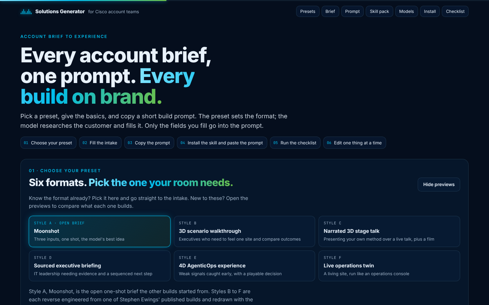

## Contents

- [What it does](#what-it-does)
- [Quick start](#quick-start)
- [How to use it](#how-to-use-it)
- [The six presets](#the-six-presets)
- [Core principles and guided mode](#core-principles-and-guided-mode)
- [What goes into the prompt](#what-goes-into-the-prompt)
- [Talking instead of typing](#talking-instead-of-typing)
- [Models and orchestration](#models-and-orchestration)
- [Installing the cisco-3d-stage skill](#installing-the-cisco-3d-stage-skill)
- [Before you present](#before-you-present)
- [Privacy](#privacy)
- [Repository layout](#repository-layout)
- [Credits](#credits)

## What it does

The generator is a single HTML page with no build step and no server. It does four things:

1. **Shows six presentation formats** as previews, each rebuilt from a real account-team build, so you can choose the one your audience needs.
2. **Collects a short brief**: who the customer is, who will be in the room, what the focus is, and a few optional details. Only the fields you fill go into the prompt; the model researches everything else.
3. **Assembles the build prompt live** as you type. It always asks the model to research the customer's recent business initiatives, strategy, filings, announcements and incidents first, then to build the chosen format.
4. **Carries the working rules** that make the build come out right: build straight through without stopping for approval, work within a time budget, create a masterpiece, run as a multi-agent build, and use the `cisco-3d-stage` skill for every visual.

## Quick start

1. Open `index.html` in Chrome, Edge or Safari. You can also host the folder anywhere static files are served, for example GitHub Pages: Settings, Pages, deploy from the `main` branch root.
2. Pick a preset, fill in the intake, and press **Copy prompt**.
3. Install the `cisco-3d-stage` skill in your AI tool (see [Installing the skill](#installing-the-cisco-3d-stage-skill)).
4. Paste the prompt into Claude Code (recommended) or another agentic coding tool, in its normal or auto mode, not plan mode.

## How to use it

The page follows six steps, top to bottom.

### 01 · Choose your preset

Six format cards sit at the top of the page. Pick one and go straight to the intake, or open the previews to compare what each format builds. Each preview has numbered callouts, a "best for" line, what the skill engine adds, and links to the live reference builds. Returning users see the previews collapsed; **Show previews** opens them again.

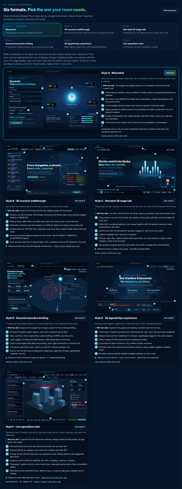

### 02 · Fill the intake

Three fields are all you need:

| Field | What to enter |
| --- | --- |
| Who the customer is | The organization and what it does, in a sentence. |
| Who will be in the room | Roles, seniority and the decision they own. |
| What you want the focus to be | The solution, use case or business problem to build around. |

Then set:

- **Who it's for.** *The customer* produces a customer-facing experience: it speaks to their priorities, keeps the research in the background, is narrated end to end so you can send it as a link or video, and has speaker notes so you can present it live. *Our account team* produces an internal explainer of a specific tool or solution in the customer's context, with background, sources, talk tracks and discovery questions.
- **Build time budget** (30 minutes to 8 hours): how long the model may work. It is a ceiling, not a target.
- **Experience length** (about 5 to 45 minutes, or let the model decide): how long the full narrated run lasts.
- **Core principles**: see [Core principles and guided mode](#core-principles-and-guided-mode).

Moonshot adds two optional fields: context only you can give (anything not publicly documented) and personas (a wide range chosen for the audience, or specific roles you list). Styles B to F show optional fields for things you already know: where the customer is today, must-include items, personas, places, scenarios, assumptions and output.

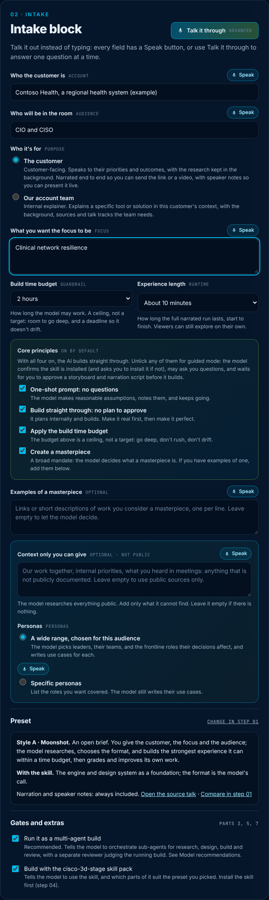

### 03 · Copy the prompt

The prompt panel shows readiness checks (what is set, what is missing, which mode you are in), the assembled prompt, and **Copy prompt**. Empty required fields show as highlighted `TBD`.

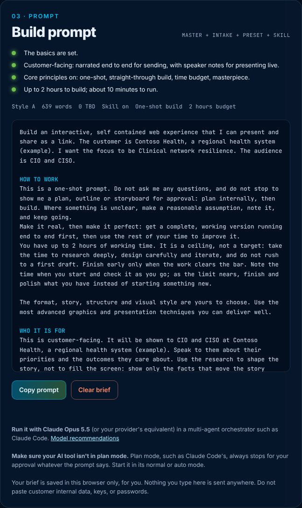

### 04 · Install the skill and paste the prompt

Install `cisco-3d-stage` once (see below), then paste the prompt into your AI tool. With the core principles on, it researches, builds and refines without stopping. In guided mode it checks the skill, may ask questions, and waits for you to approve a storyboard and narration script.

### 05 · Run the checklist

Tick through the pre-presentation checklist before you put the build in front of a customer. Your ticks are saved in your browser.

### 06 · Refine

After the first build, change one thing at a time in plain language. Never regenerate the whole experience to fix one detail.

## The six presets

| Style | Name | Best for | Reference build |
| --- | --- | --- | --- |
| A | **Moonshot** (open brief) | When you want the model's best idea rather than a recreation. Three inputs, one shot, the format is the model's call. | The one-shot workshop prompt from *A spoken word away* |
| B | **3D scenario walkthrough** | Executives who need to feel one site and compare outcomes side by side. A 3D map and representative site, a guided story, every scenario shown without and with Cisco. | [Securing CSX Wayside Infrastructure](https://rapid-rafter-dk38.here.now/) |
| C | **Narrated 3D stage talk** | Presenting your own method or story live, plus a self-playing film edition with an AI narrator. The skill's native format. | [A spoken word away · FutureSE narrated edition](https://brisk-valley-7hw3.here.now/) |
| D | **Sourced executive briefing** | IT leadership that needs evidence: a 3D digital twin with a guided story, sourced headline figures, then a long scrolling briefing and roadmap. | [Dominion Energy and Splunk · IT Leadership Briefing](https://hollow-flame-f2tf.here.now/) |
| E | **4D AgenticOps experience** | Weak signals caught early, in business terms: a globe to building to floor, missions that compare a traditional timeline with an AgenticOps timeline, and a playable decision. | [MetLife x Cisco Cloud Control · AgenticOps 4D](https://rosy-beacon-q5c8.here.now/) |
| F | **Live operations twin** | Operations and IT leaders who want to see their whole site live, inject a bad day, and watch the difference. | [MSK Operations Twin](https://topaz-kernel-3cga.here.now/) and [Deltaverse · ATL Digital Twin](https://dapper-ginger-cs9a.here.now/) |

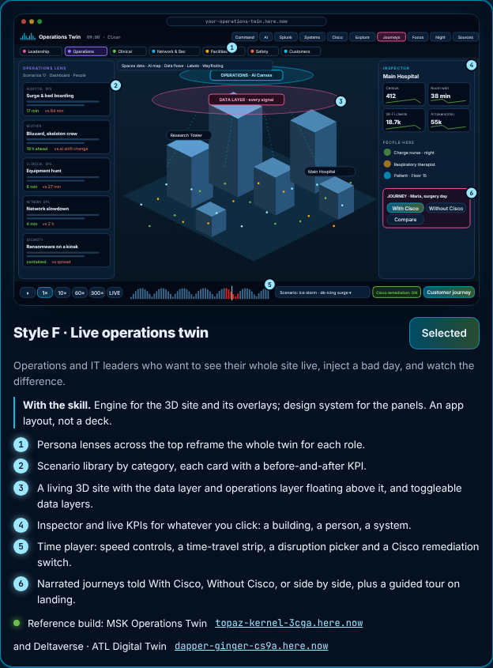

### Optional components

Styles B to F can add any of 14 components, each written generically into the prompt only when ticked. Style F starts with all of them ticked; B to E start with none. The page remembers your ticks for each style.

Guided tour · narrated journeys (with Cisco, without Cisco, compare) · persona lenses · scenario library and player · disruption injector with a Cisco remediation switch · drill-down interiors · data layers · time controls and live data · executive dashboards · AI usage and tokenomics · technology stack view · inspector panel · people directory · sources and methodology.

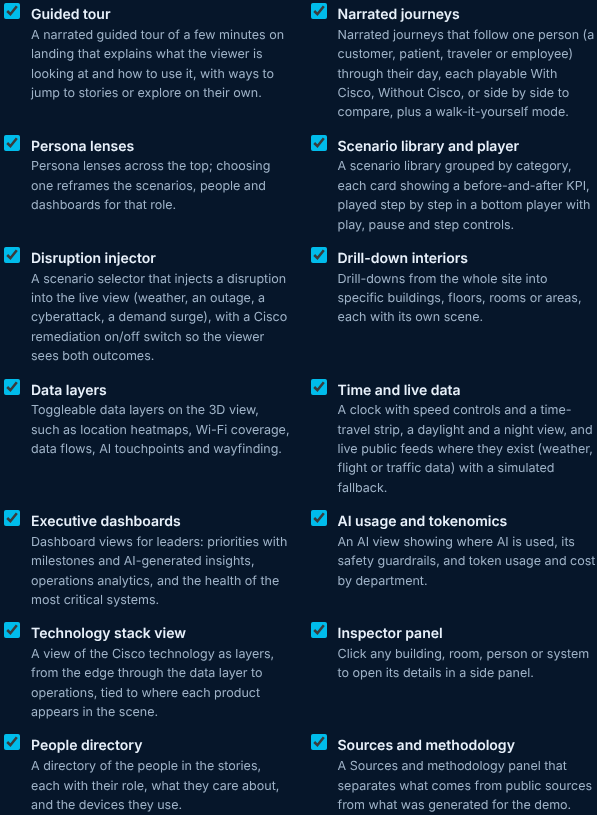

## Core principles and guided mode

Four principles are on by default for every style. Together they make the AI tool build instead of stopping to ask.

| Principle | What it adds to the prompt |
| --- | --- |
| One-shot prompt: no questions | Do not ask questions; make reasonable assumptions, note them, and keep going. |
| Build straight through | Do not stop to show a plan, outline or storyboard for approval. Plan internally, then build. Make it real first, then make it perfect. |
| Apply the build time budget | Up to the chosen time; a ceiling, not a target. Research deeply, do not rush, check the clock, and as the limit nears, finish and polish instead of starting something new. |
| Create a masterpiece | "Create a masterpiece." A broad mandate: the model decides what a masterpiece is. Add your own examples in the optional field if you have them. |

**Untick any principle for guided mode.** The prompt then becomes a numbered, collaborative process:

1. Confirm the `cisco-3d-stage` skill is installed. If it cannot be found, stop and ask the user to install it.
2. Ask up to three short questions (only if one-shot is off).
3. Research, then show a storyboard and the narration script, and wait for approval.
4. Build to the approved storyboard and script.
5. List every estimate and assumption for review before presenting.

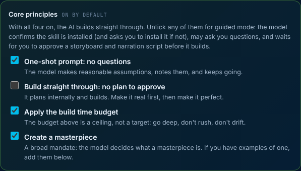

## What goes into the prompt

Every prompt is short and generic, so the model's own research shapes the story. The sections, in order:

| Section | Contents |
| --- | --- |
| Opening line | The customer, the audience and the focus. |
| How to work | The core principles, or the guided process. |
| Who it is for | Customer-facing or internal explainer, with narration and speaker notes. |
| Length | The narrated runtime. |
| Research | The customer's business, strategy, current initiatives and anything recent: earnings calls, filings, announcements, leadership changes, incidents and regulatory news, prioritizing the last 12 months. Then the Cisco solutions that fit. |
| What I already know | Only the optional fields you filled (styles B to F). |
| Style | The format to build exactly, plus any optional components you ticked (styles B to F). Moonshot leaves the format to the model. |
| How to run this | Orchestrate sub-agents for research, design, build and review, with a separate reviewer. |
| Skill | Use `cisco-3d-stage` for every visual. In one-shot mode, check it is installed and report if it was missing; in guided mode, stop and ask. |
| Create a masterpiece | The mandate, plus your examples if any. |
| Hand-back | The link, the assumptions made, and whether the skill was installed. |

## Talking instead of typing

The generator is built to encourage talking the intake out.

- **Speak buttons** sit on every text field and start live dictation. Where the browser or the hosting page blocks the microphone (the claude.ai viewer does), the cursor moves into the field and the page shows your computer's own dictation shortcut: press Fn twice on a Mac, or Win + H on Windows.
- **Talk it through** (advanced) opens a full-screen interview that asks one question at a time, adapted to the preset and to who the build is for. It can read each question aloud and listen automatically, and you can say "next", "skip" or "go back". Answers fill the intake as you go, and the last question takes you to the prompt.

Live in-page dictation works when `index.html` is opened directly in Chrome or Edge.

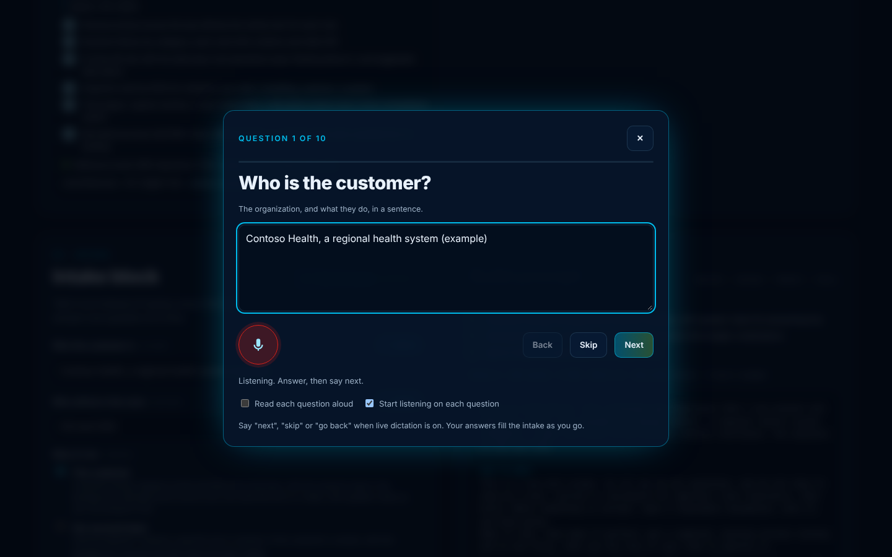

## Models and orchestration

Always run the prompt in a multi-agent orchestrator on the most capable model available.

| Provider | Orchestrator | Sub-agents | Where to run it |
| --- | --- | --- | --- |
| Anthropic (recommended) | Claude Opus 5.5 (`claude-opus-5-5`) with effort set to high or xhigh, since its default is medium. Claude Fable 5.1 (`claude-fable-5-1`) for the hardest builds. | Claude Sonnet 5.5 for review, Claude Haiku 5.5 for research. | Claude Code with sub-agents, the Claude Agent SDK, or Claude Managed Agents. |
| OpenAI | The most capable GPT model available (GPT-5.5 at the time of writing). | A smaller model from the same family. | Codex |
| Google | The most capable Gemini model available (the Gemini 3.5 family at the time of writing). | Gemini Flash. | Antigravity |

A prompt can only ask a model to respect a time budget. To enforce it, set a limit in the tool as well: a session budget in Claude Managed Agents, a task budget on the Claude API, or stop a Claude Code session at the deadline. Model lineups change often, so confirm the current top model with each provider.

Start your AI tool in its normal or auto mode. Plan mode always stops for approval, whatever the prompt says.

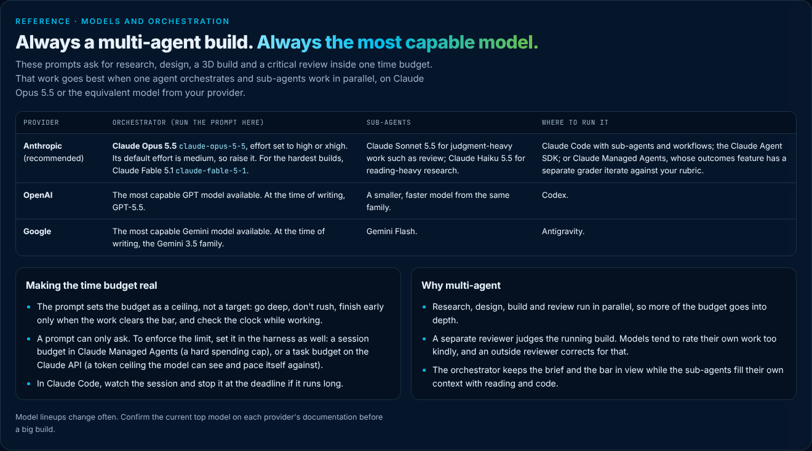

## Installing the cisco-3d-stage skill

The generator's prompts build on `cisco-3d-stage`, an agent skill created by Stephen Ewings (Solutions Engineer, Cisco). It packages the Cisco midnight palette, Inter type, glass HUD, a Three.js stage engine that moves like a deck, presenter tools, a narrated film edition, and headless review tools. Get it from the SEVerse-Skill repository (Code, then Download ZIP saves `SEVerse-Skill-main.zip`).

**Claude Code**

```bash
unzip SEVerse-Skill-main.zip
```

```bash
mkdir -p ~/.claude/skills && cp -R SEVerse-Skill-main/cisco-3d-stage ~/.claude/skills/
```

For a project install shared with everyone who clones the repo, copy it to `.claude/skills/` in the project instead. Cloud sessions need the project install.

**Claude app:** zip the `cisco-3d-stage` folder on its own and upload it under Settings, Capabilities, Skills. The app can plan and write; the full build, voice rendering and review need a terminal.

**Cursor**

```bash
mkdir -p ~/.cursor/skills && cp -R SEVerse-Skill-main/cisco-3d-stage ~/.cursor/skills/
```

**Check the starter runs**

```bash
cd ~/.claude/skills/cisco-3d-stage/starter && python3 -m http.server 8765
```

Then open `http://localhost:8765/`.

The skill's `examples/` folder holds screenshots of internal customer talks. Keep it inside Cisco. The base `cisco-branded` design-system skill is referenced by `cisco-3d-stage` but is not part of that pack.

### Dependencies

| Component | Needed for | How you get it |
| --- | --- | --- |
| three.js r170, Inter, JetBrains Mono | The 3D stage and type | Vendored in the skill's starter |
| Python 3.9+ | Local server, audio rendering | Preinstalled on macOS and most Linux |
| Node.js 18+ | Narration export, docs, headless review | nodejs.org |
| edge-tts | Pre-rendering narration voices | `pip install edge-tts` |
| rangehttpserver | A local server that lets the film scrubber seek | `pip install rangehttpserver` |
| puppeteer-core | Headless review screenshots | `npm i -D puppeteer-core` |

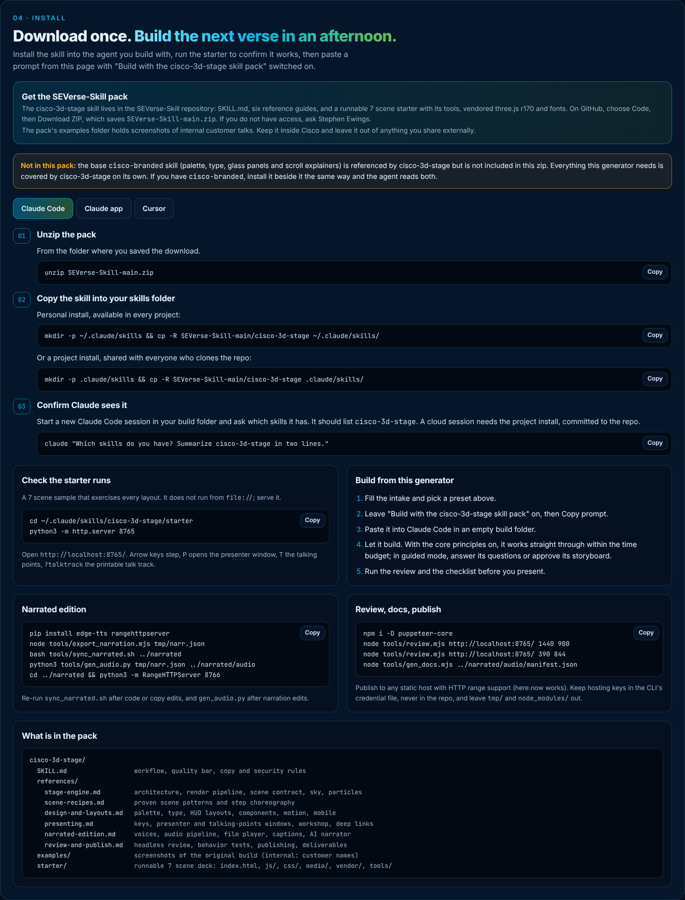

### Design system reference

The page also documents the skill's design system: palette and block colors, type, the four HUD layouts (stack, hero, focus, workshop), what stays fixed and what changes per build, scene recipes, copy rules (no em dashes, two-clause headlines, numbered eyebrows), the quality bar and security rules.

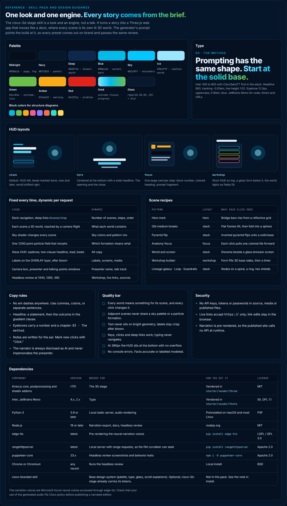

## Before you present

- Every public claim has a source.
- Every estimate is marked as one where it appears.
- Every assumption is listed.
- No customer internal data appears anywhere, and no dashboard is presented as real customer data.
- The without-Cisco view describes today's way of working fairly.
- Every agent action ends at a human approval gate.
- The build matches the preset and the brief.
- Links, narration and share controls work from a clean browser session.

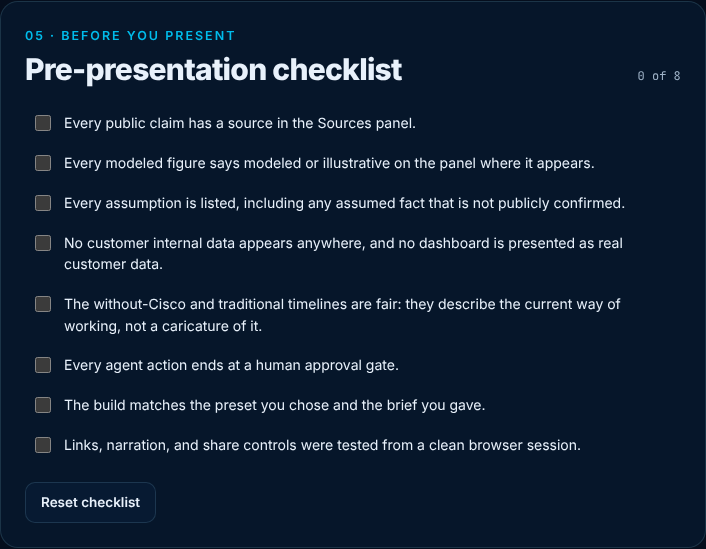

## Privacy

Everything runs in your browser. Your brief, ticked components and checklist are saved in your browser's local storage, for you only. Nothing you type is sent anywhere. Do not paste customer internal data, keys or passwords into the intake.

The page loads Inter and JetBrains Mono from Google Fonts and needs no other network access.

## Repository layout

```text
index.html             The generator: one self-contained page (HTML, CSS and JavaScript)
README.md              This guide
docs/screenshots/      Screenshots used in this guide
```

The page works at phone width too.

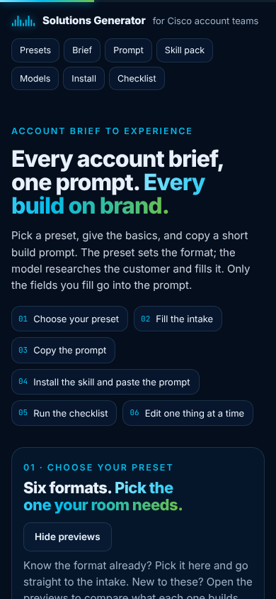

## Credits

- The four presentation styles B to F are modeled on builds by Stephen Ewings (Solutions Engineer, Cisco), used as structure references. The customer names shown refer to those builds; replace them in new work.
- `cisco-3d-stage` skill: Stephen Ewings, from the SEVerse-Skill repository. Third-party components are listed in its `THIRD_PARTY_NOTICES.md`.
- Method adapted from Futurepedia, *Claude Makes a New Kind of Video, Full Tutorial*, by Kevin Hutson: <https://www.youtube.com/watch?v=Ge1B-Ok1Pfk>.
- Cisco names and marks belong to Cisco Systems, Inc.
